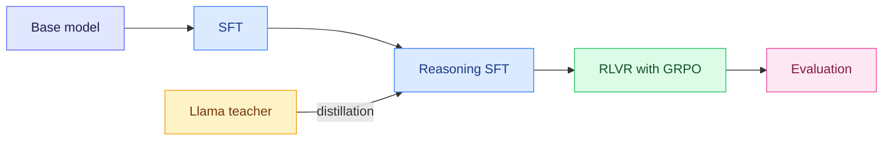

<div align="center">

# 🧠 ReWild: Reasoning with SFT → RLVR

**Teaching language models to reason: supervised fine-tuning, distillation, and reinforcement learning with verifiable rewards (GRPO).**


[Overview](#-overview) · [Pipeline](#-pipeline) · [Repository Structure](#-repository-structure) · [Getting Started](#-getting-started) · [Results](#-results) · [Roadmap](#-roadmap) · [Citation](#-citation)

</div>

---

## ✨ Overview

This repository collects our experiments on **post-training a language model for reasoning** in the ReWild setting. It walks through the full recipe in self-contained notebooks:

- 📚 **Supervised Fine-Tuning (SFT)** to give the model a solid starting policy
- 🪄 **Reasoning SFT** on step-by-step reasoning traces
- 🦙 **Distillation** from a Llama teacher into a smaller student
- 🎯 **RLVR**: reinforcement learning with *verifiable* rewards
- ⚡ **GRPO** (Group Relative Policy Optimization), a memory-friendly RL algorithm that needs no separate value model

Each stage lives in its own folder, so you can run them one at a time or chain them end to end.

> **Why SFT *and* RLVR?** SFT is good at injecting new knowledge and reasoning patterns. RLVR is good at sharpening reasoning with a reward signal that can be checked automatically (for example, "is the final answer correct?"). Used together, they cover each other's weaknesses.

---

## 🔬 Pipeline



| Stage | What happens | Why it matters |
|---|---|---|
| **1. SFT** | Fine-tune the base model on curated instruction/answer data | Establishes format and baseline capability |
| **2. Reasoning SFT** | Train on explicit chain-of-thought traces | Teaches the model to "show its work" |
| **3. Distillation** | Learn from a stronger Llama teacher's outputs | Transfers reasoning into a cheaper model |
| **4. RLVR / GRPO** | Sample groups of answers, reward the verifiably correct ones | Improves reasoning beyond imitation |

---

## 📁 Repository Structure

```
rewild-reasoning-sft-rlvr/
├── Rewild_SFT/                 # Stage 1: supervised fine-tuning
├── Rewild_ReasoningSFT/        # Stage 2: SFT on reasoning traces
├── Rewild_llama_distillation/  # Stage 3: distillation from a Llama teacher
├── Rewild_RLVR/                # Stage 4: RL with verifiable rewards
├── Rewild_GRPO/                # Stage 4: GRPO training notebooks
└── README.md
```

| Folder | Purpose |
|---|---|
| [`Rewild_SFT`](./Rewild_SFT) | Baseline supervised fine-tuning |
| [`Rewild_ReasoningSFT`](./Rewild_ReasoningSFT) | Reasoning-focused SFT with step-by-step traces |
| [`Rewild_llama_distillation`](./Rewild_llama_distillation) | Knowledge distillation using Llama |
| [`Rewild_RLVR`](./Rewild_RLVR) | Reinforcement learning with verifiable rewards |
| [`Rewild_GRPO`](./Rewild_GRPO) | Group Relative Policy Optimization experiments |

---

## 🚀 Getting Started

### Prerequisites

- Python **3.10+**
- A GPU (CUDA) or Apple Silicon (MPS) with enough memory for your chosen model size
- A Hugging Face account/token if you use gated models (for example, Llama)

### Installation

```bash
# 1. Clone the repository
git clone https://github.com/PritiShinde-BITS/rewild-reasoning-sft-rlvr.git
cd rewild-reasoning-sft-rlvr

# 2. Create an environment
python -m venv .venv
source .venv/bin/activate        # Windows: .venv\Scripts\activate

# 3. Install dependencies
pip install torch transformers datasets accelerate peft trl jupyter
```

> 💡 Pin exact versions in a `requirements.txt` so runs are reproducible.

### Running the notebooks

```bash
jupyter lab
```

Then open the notebook in the stage you want. For the full recipe, run the stages in order:

1. `Rewild_SFT`
2. `Rewild_ReasoningSFT`
3. `Rewild_llama_distillation`
4. `Rewild_RLVR` / `Rewild_GRPO`

---

## 📊 Results

> Fill in your numbers here. A small, honest table is more convincing than a long one.

| Model | Stage | Accuracy |
|---|---|---|
| Base model | – | _TBD_ |
| + SFT | 1 | _TBD_ |
| + Reasoning SFT | 2 | _TBD_ |
| + Distillation | 3 | _TBD_ |
| + RLVR / GRPO | 4 | _TBD_ |

**Evaluation setup:** _dataset, split, metric, number of samples, decoding settings (temperature, max tokens)._

---

## 🗺️ Roadmap

- [ ] Add a `requirements.txt` / `environment.yml`
- [ ] Add a results table and training curves
- [ ] Document the dataset and reward function used for RLVR
- [ ] Add a short "how to reproduce" guide per folder
- [ ] Publish trained checkpoints

---

## 🤝 Contributing

Issues and pull requests are welcome. If you'd like to try a new reward function, base model, or training recipe, open an issue first so we can discuss it.

---

## 📚 Citation

If you build on this work, please cite the repository:

```bibtex
@misc{rewild_reasoning_sft_rlvr,
  title  = {ReWild: Reasoning with SFT and RLVR},
  author = {Shinde, Priti and contributors},
  year   = {2026},
  url    = {https://github.com/PritiShinde-BITS/rewild-reasoning-sft-rlvr}
}
```

---

## 🙏 Acknowledgements

- The **ReWild** authors for the foundational work this repo builds on
- [Hugging Face](https://huggingface.co/) 🤗 Transformers, Datasets, PEFT, and TRL
- The DeepSeek team for popularizing **GRPO** and RLVR for reasoning

---

<div align="center">

⭐ If you find this useful, consider starring the repo!

</div>
